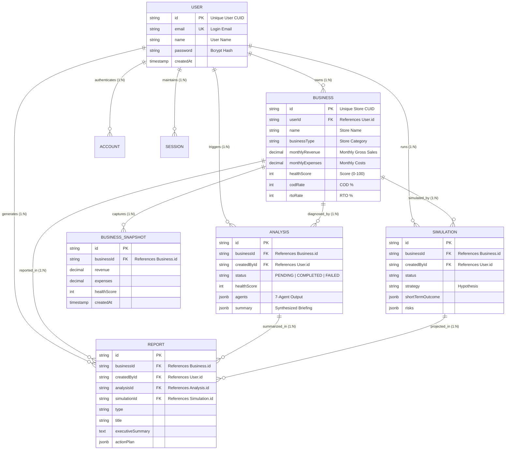

# FULL STACK DEVELOPMENT - I (PS-FSD)
## FORMATIVE ASSIGNMENT - 1 (FA-1)
**Academic Year:** 2026-27 | **Semester:** V  
**Project:** GrowthOS — The AI Growth Operating System for E-Commerce Brands  
**Bloom's Taxonomy Levels:** L4 (Analyze) & L6 (Create)  

---

### Executive Summary
GrowthOS is a full-stack SaaS platform designed for direct-to-consumer (D2C) e-commerce brands. It tracks core business KPIs (Revenue, COGS, CAC, ROAS, RTO, Cart Abandonment), executes a parallel 7-agent LLM diagnostic pipeline, simulates growth strategies, and generates executive CEO reports. 

Below is the database structure, Entity-Relationship (ER) model, entity attribute breakdown, relationship cardinality analysis, and relational integrity validation for GrowthOS.

---

### Task (a): Entity Identification & Attributes Specification

#### 1. `User` Entity (Authentication & Identity)
| Attribute | Data Type | Constraint | Description |
|---|---|---|---|
| `id` | VARCHAR(36) / String | **PK** (Primary Key, CUID) | Unique user identifier |
| `email` | VARCHAR(255) | **UNIQUE, NOT NULL** | Login email and primary identity |
| `name` | VARCHAR(255) | NULLABLE | Founder full name |
| `password` | VARCHAR(255) | NULLABLE | Bcrypt-hashed password |
| `emailVerified` | TIMESTAMP | NULLABLE | Email verification timestamp |
| `image` | TEXT | NULLABLE | OAuth avatar URL |
| `createdAt` | TIMESTAMP | DEFAULT NOW(), NOT NULL | Audit creation timestamp |
| `updatedAt` | TIMESTAMP | DEFAULT NOW(), NOT NULL | Audit update timestamp |

#### 2. `Business` Entity (Storefront & Operating Metrics)
| Attribute | Data Type | Constraint | Description |
|---|---|---|---|
| `id` | VARCHAR(36) | **PK** | Unique business identifier |
| `userId` | VARCHAR(36) | **FK** -> `User.id`, NOT NULL | Owner reference (ON DELETE CASCADE) |
| `name` | VARCHAR(255) | NOT NULL | Store / brand name |
| `businessType` | ENUM / VARCHAR(50) | NOT NULL, DEFAULT 'ECOMMERCE' | Category (ECOMMERCE, RETAIL, D2C) |
| `industry` | VARCHAR(100) | NULLABLE | Sub-vertical (Apparel, Beauty, Food) |
| `monthlyRevenue` | DECIMAL(14,2) | NULLABLE | Gross monthly sales in INR |
| `monthlyExpenses` | DECIMAL(14,2) | NULLABLE | Total monthly operating expenses |
| `customersPerMonth`| INTEGER | NULLABLE | Unique transacting customers count |
| `repeatCustomerPercentage` | INTEGER | CHECK (0-100) | Repeat customer rate % |
| `marketingChannels` | TEXT[] | DEFAULT '{}' | Channels (Meta Ads, Google, Influencers) |
| `pricingLevel` | ENUM | NOT NULL | LOW, MEDIUM, HIGH |
| `healthScore` | INTEGER | CHECK (0-100) | Composite AI diagnostic health score |
| `averageOrderValue` | DECIMAL(10,2) | NULLABLE | Blended AOV in INR |
| `customerAcquisitionCost` | DECIMAL(10,2) | NULLABLE | Blended CAC in INR |
| `returnOnAdSpend` | DECIMAL(6,2) | NULLABLE | ROAS multiplier (e.g. 2.80x) |
| `cartAbandonmentRate` | INTEGER | CHECK (0-100) | Cart drop-off percentage |
| `inventoryTurnover` | DECIMAL(6,2) | NULLABLE | Annual inventory turns ratio |
| `codRate` | INTEGER | CHECK (0-100) | Cash on Delivery order percentage |
| `rtoRate` | INTEGER | CHECK (0-100) | Return to Origin failure percentage |
| `prepaidPercentage` | INTEGER | CHECK (0-100) | Prepaid transaction percentage |
| `createdAt` | TIMESTAMP | DEFAULT NOW(), NOT NULL | Store record creation timestamp |

#### 3. `BusinessSnapshot` Entity (Time-Series Metric History)
| Attribute | Data Type | Constraint | Description |
|---|---|---|---|
| `id` | VARCHAR(36) | **PK** | Snapshot ID |
| `businessId` | VARCHAR(36) | **FK** -> `Business.id`, NOT NULL | Reference to store (ON DELETE CASCADE) |
| `revenue` | DECIMAL(14,2) | NULLABLE | Snapshot revenue |
| `expenses` | DECIMAL(14,2) | NULLABLE | Snapshot expenses |
| `customers` | INTEGER | NULLABLE | Snapshot customer volume |
| `healthScore` | INTEGER | NULLABLE | Health score at snapshot time |
| `averageOrderValue` | DECIMAL(10,2) | NULLABLE | AOV at snapshot time |
| `customerAcquisitionCost` | DECIMAL(10,2) | NULLABLE | CAC at snapshot time |
| `returnOnAdSpend` | DECIMAL(6,2) | NULLABLE | ROAS at snapshot time |
| `codRate` | INTEGER | NULLABLE | COD rate at snapshot time |
| `rtoRate` | INTEGER | NULLABLE | RTO rate at snapshot time |
| `createdAt` | TIMESTAMP | DEFAULT NOW(), NOT NULL | Snapshot timestamp (enables time-series trends) |

#### 4. `Analysis` Entity (7-Agent Diagnostic Run)
| Attribute | Data Type | Constraint | Description |
|---|---|---|---|
| `id` | VARCHAR(36) | **PK** | Diagnosis run identifier |
| `businessId` | VARCHAR(36) | **FK** -> `Business.id`, NOT NULL | Store diagnosed (ON DELETE CASCADE) |
| `createdById` | VARCHAR(36) | **FK** -> `User.id`, NULLABLE | User initiating diagnosis (ON DELETE SET NULL) |
| `status` | ENUM | PENDING, IN_PROGRESS, COMPLETED, FAILED | Pipeline execution state |
| `healthScore` | INTEGER | CHECK (0-100) | Overall health rating computed by 7 agents |
| `summary` | JSONB | NULLABLE | Synthesized executive diagnosis findings |
| `agents` | JSONB | NULLABLE | Detailed breakdown for each of the 7 agents |
| `inputSnapshot` | JSONB | NULLABLE | Immutable snapshot of inputs used |
| `createdAt` | TIMESTAMP | DEFAULT NOW(), NOT NULL | Run timestamp |

#### 5. `Simulation` Entity (Strategy Forecasting)
| Attribute | Data Type | Constraint | Description |
|---|---|---|---|
| `id` | VARCHAR(36) | **PK** | Simulation identifier |
| `businessId` | VARCHAR(36) | **FK** -> `Business.id`, NOT NULL | Store simulated (ON DELETE CASCADE) |
| `createdById` | VARCHAR(36) | **FK** -> `User.id`, NULLABLE | Initiator reference (ON DELETE SET NULL) |
| `status` | ENUM | PENDING, COMPLETED, FAILED | Simulation run status |
| `strategy` | TEXT | NOT NULL | User hypothesis (e.g. "Cut ad spend 20%") |
| `shortTermOutcome` | JSONB | NULLABLE | 30-90 day forecasted impact |
| `longTermOutcome` | JSONB | NULLABLE | 6-12 month forecasted impact |
| `risks` | JSONB | NULLABLE | Identified risks and failure modes |
| `opportunities` | JSONB | NULLABLE | Identified upside opportunities |
| `confidenceScore` | INTEGER | CHECK (0-100) | AI confidence index |

#### 6. `Report` Entity (Executive CEO Report & Artifacts)
| Attribute | Data Type | Constraint | Description |
|---|---|---|---|
| `id` | VARCHAR(36) | **PK** | Report record ID |
| `businessId` | VARCHAR(36) | **FK** -> `Business.id`, NOT NULL | Target store (ON DELETE CASCADE) |
| `createdById` | VARCHAR(36) | **FK** -> `User.id`, NULLABLE | Creator reference (ON DELETE SET NULL) |
| `analysisId` | VARCHAR(36) | **FK** -> `Analysis.id`, NULLABLE | Linked diagnosis (ON DELETE SET NULL) |
| `simulationId` | VARCHAR(36) | **FK** -> `Simulation.id`, NULLABLE | Linked simulation (ON DELETE SET NULL) |
| `type` | ENUM | DIAGNOSIS, SIMULATION, EXECUTIVE_SUMMARY | Report type |
| `title` | VARCHAR(255) | NOT NULL | Report title |
| `executiveSummary`| TEXT | NULLABLE | Founder executive summary |
| `chiefRisk` | TEXT | NULLABLE | Highest severity operational threat |
| `topOpportunity` | TEXT | NULLABLE | Primary growth lever |
| `immediateAction` | TEXT | NULLABLE | Tactical 7-day priority |
| `actionPlan` | JSONB | NULLABLE | Step-by-step roadmap with assigned tools |
| `createdAt` | TIMESTAMP | DEFAULT NOW(), NOT NULL | Report generation timestamp |

---

### Task (b): Relational Analysis & Cardinality Specification

| Relationship | Parent | Child | Type & Cardinality | Foreign Key | Cascade Policy | Real-World Business Rationale |
|---|---|---|---|---|---|---|
| User owns Businesses | `User` | `Business` | **1 : N** (One-to-Many) | `Business.userId` | ON DELETE CASCADE | A founder can register and manage multiple D2C brands. Deleting user cleans up all stores. |
| Business has Snapshots | `Business` | `BusinessSnapshot` | **1 : N** (One-to-Many) | `BusinessSnapshot.businessId` | ON DELETE CASCADE | A store records continuous historical snapshots to render longitudinal KPI charts. |
| Business has Diagnoses | `Business` | `Analysis` | **1 : N** (One-to-Many) | `Analysis.businessId` | ON DELETE CASCADE | Stores run multiple 7-agent AI diagnoses over time. |
| User initiates Diagnosis | `User` | `Analysis` | **1 : N** (One-to-Many) | `Analysis.createdById` | ON DELETE SET NULL | Tracks audit trail of who initiated the analysis; retains analysis if user leaves team. |
| Business runs Simulations | `Business` | `Simulation` | **1 : N** (One-to-Many) | `Simulation.businessId` | ON DELETE CASCADE | Stores run what-if scenario simulations. |
| Business generates Reports | `Business` | `Report` | **1 : N** (One-to-Many) | `Report.businessId` | ON DELETE CASCADE | Reports belong to a specific store profile. |
| Diagnosis linked to Report | `Analysis` | `Report` | **1 : N** (One-to-Many) | `Report.analysisId` | ON DELETE SET NULL | A diagnosis run can be synthesized into exportable executive PDF reports. |
| Simulation linked to Report| `Simulation`| `Report` | **1 : N** (One-to-Many) | `Report.simulationId` | ON DELETE SET NULL | Strategic simulation results can be exported as strategic reports. |

---

### Task (c): Complete Entity-Relationship (ER) Diagram

---

### Task (d): Consistency Verification & Architectural Justification

1. **Strict Relational Integrity vs. Flexible AI Payloads:**  
   - Relational entities (`User`, `Business`, `BusinessSnapshot`) enforce relational integrity, strict foreign keys, and typed check constraints.  
   - AI diagnostic payloads (`agents`, `summary`, `actionPlan`) utilize PostgreSQL **JSONB** columns. This allows all 7 agents to produce deep nested JSON structures (insights, problem statements, actionable SOPs, tool integrations) without requiring 15+ sub-tables and complex join queries, achieving sub-4 second response times.
2. **CUID Primary Keys vs. Sequential Integers:**  
   - Traditional auto-increment integer IDs are vulnerable to sequential enumeration attacks. GrowthOS uses CUIDs (Collision-resistant Unique Identifiers) as strings for all Primary Keys, which are URL-safe, globally unique, and horizontally scalable.
3. **Precision Financial Decimal Types:**  
   - Revenue, Expenses, CAC, and AOV utilize `DECIMAL(14,2)` and `DECIMAL(10,2)` in PostgreSQL to prevent binary floating-point rounding errors common in IEEE-754 floats.
4. **Referential Cascade Policies:**  
   - Explicit `CASCADE` on `Business -> Snapshots` ensures no orphan metrics remain when a store is deleted.
   - `SET NULL` on `User -> Analysis/Reports` ensures that organizational intelligence and historical CEO briefings remain intact even if an individual employee account is decommissioned.
